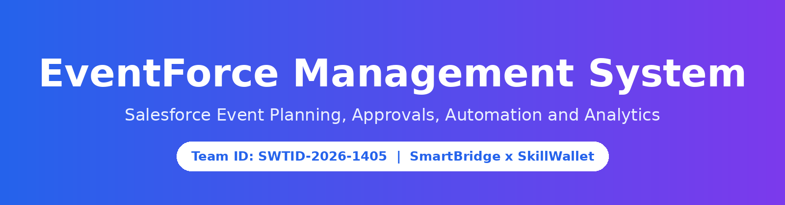
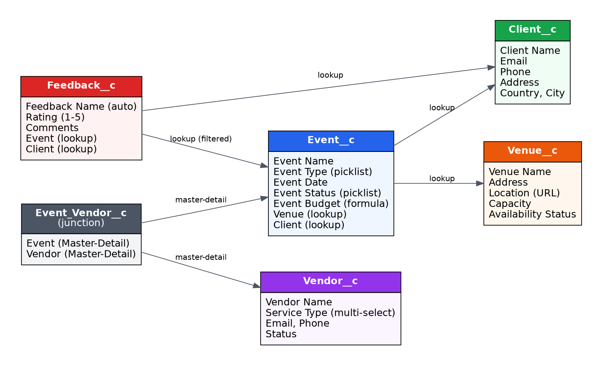
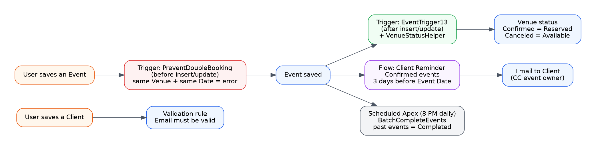
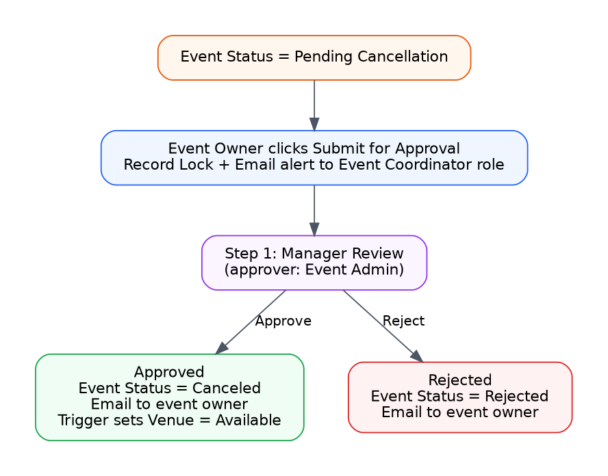
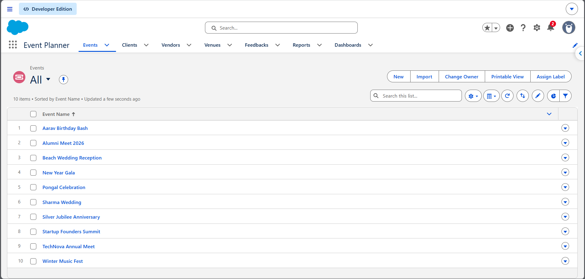
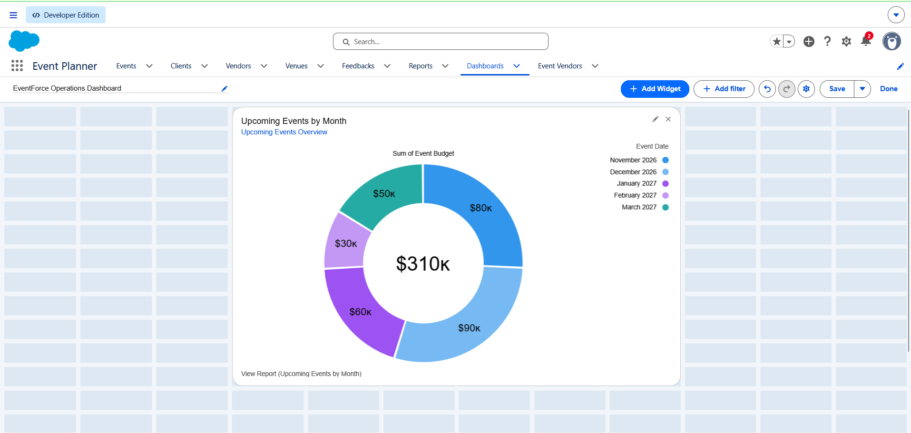
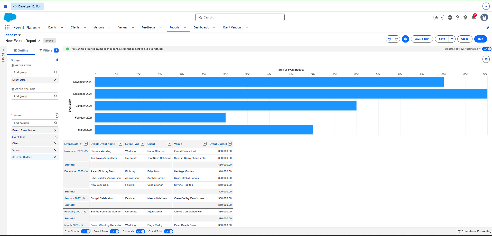
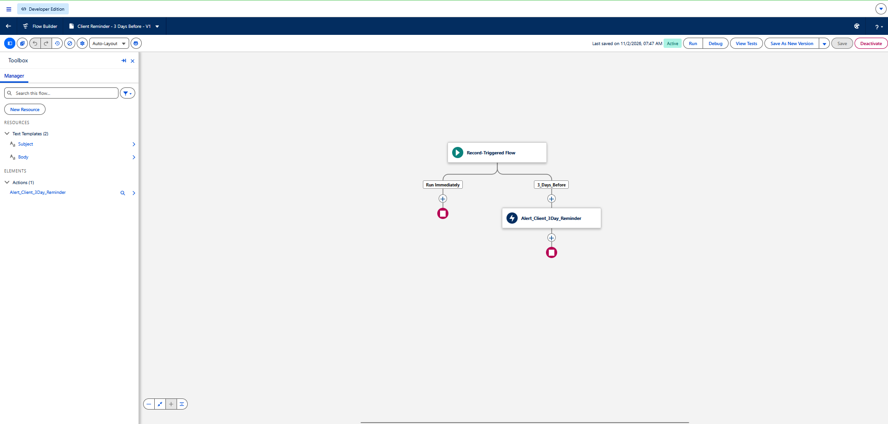
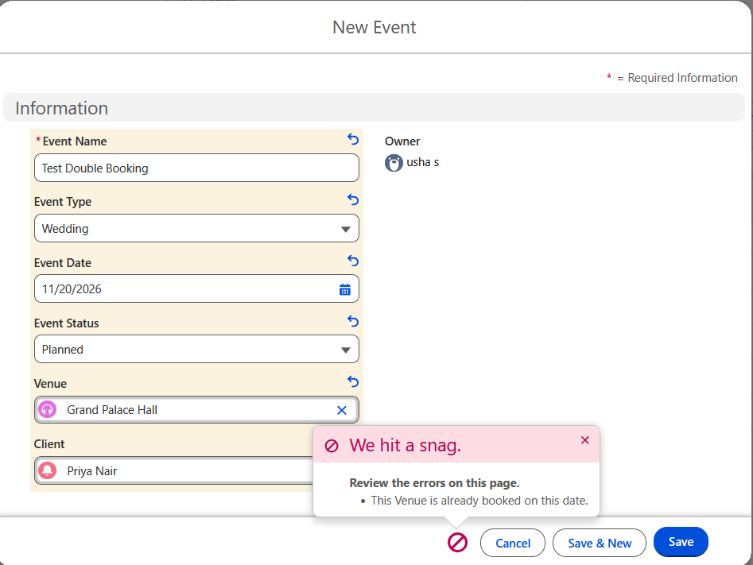
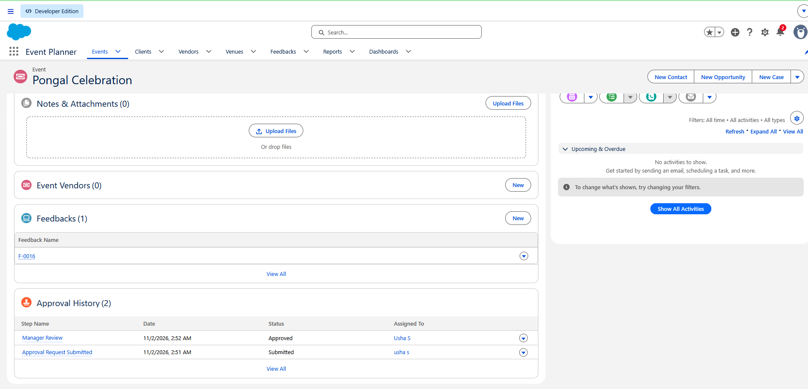

<p align="center"></p>

<p align="center">
  
  
  
  
  
  
</p>

# EventForce Management System

A Salesforce Lightning application that helps an event company plan and run events end to end: clients, venues, vendors, feedback, cancellation approvals, automatic reminders, and live reporting.

> **Team ID:** SWTID-2026-1405 | **Program:** SmartBridge x SkillWallet Salesforce project
> **College:** P.B. College of Engineering, B.Tech Information Technology
> **Demo video:** [Watch EventForce Project Demo](https://drive.google.com/file/d/10dreKtevFhDOkYQFvfSX7S6UVDRp4b_1/view?usp=sharing)

---

## Team

| Role | Name | Responsibility |
|---|---|---|
| **Team Leader** | **Monika P** | Ideation, design and planning documents, Lightning App, report and dashboard, final testing, demo video, GitHub repository |
| Team Member | Usha S | Custom objects, tabs, fields, relationships (Event Vendor junction), formula field, validation rule, sample data import |
| Team Member | Shobana M | Email templates, Approval Process, Flow (3-day reminder), profiles, roles, users |
| Team Member | Mujahidha Begam M | Apex triggers and classes, Batch and Scheduled Apex, permission set, OWD and sharing rule, test cases |

---

## The problem and our solution

| Problem | How EventForce solves it |
|---|---|
| Events are tracked in spreadsheets and clients are not reminded | One Salesforce app with Event, Client, Vendor, Venue and Feedback records, plus an automatic reminder email 3 days before every confirmed event |
| Two events get booked at the same venue on the same day | Apex trigger blocks the double booking with a clear error |
| Cancellations are informal | Approval Process with Pending Cancellation, Manager Review, approve or reject, and automatic status and email updates |
| Venue availability is wrong | Trigger keeps Venue status in sync: Confirmed event = Reserved, Canceled event = Available |
| Old events stay open | Scheduled Batch Apex marks past events as Completed every night |
| No management view | Report by month and a dashboard with budget analysis |

## Features

- **6 custom objects:** Event, Client, Vendor, Venue, Feedback, Event Vendor (junction)
- **Formula field:** Event Budget calculated from Event Type
- **Validation rule:** blocks invalid client email addresses
- **Approval Process:** event cancellation with email alerts and automatic field updates
- **Record-triggered Flow:** scheduled path sends the client a reminder 3 days before the event
- **Apex:** `PreventDoubleBooking`, `EventTrigger13` with `VenueStatusHelper`, `BatchCompleteEvents`, `ScheduleCompleteEvents`
- **Security:** 4 profiles, role hierarchy, permission set, Event OWD Private, sharing rule
- **UI and analytics:** Event Planner Lightning App, Upcoming Events by Month report, Operations dashboard

## Architecture



### Automation overview


### Event cancellation approval


## Screenshots

| Lightning App | Dashboard |
|---|---|
|  |  |

| Report grouped by month | Flow (active) |
|---|---|
|  |  |

| Double booking blocked | Approval completed |
|---|---|
|  |  |

More screenshots are inside each phase folder.

## Project report (written by our team, phase wise)

| Folder | Phase | Contents |
|---|---|---|
| [01-Ideation-Phase](01-Ideation-Phase) | Ideation | Problem statement, stakeholders, brainstorming, solution (PDF) |
| [02-Requirement-Analysis](02-Requirement-Analysis) | Requirement analysis | Functional and non-functional requirements, access matrix (PDF) |
| [03-Project-Design-Phase](03-Project-Design-Phase) | Project design | Architecture, ER diagram, process flows, user stories (PDF) |
| [04-Project-Planning-Scheduling](04-Project-Planning-Scheduling) | Planning | Sprint plan, responsibilities, risks (PDF) |
| [05-Dev-Phase-1-Requirement-Planning](05-Dev-Phase-1-Requirement-Planning) | Development phase 1 | Environment setup, naming standards, build order (PDF) |
| [06-Dev-Phase-2-Backend-Configuration](06-Dev-Phase-2-Backend-Configuration) | Development phase 2 | Objects, fields, validation, approval, flow, Apex (PDF + screenshots) |
| [07-Dev-Phase-3-UI-UX](07-Dev-Phase-3-UI-UX) | Development phase 3 | Lightning App, reports, dashboard (PDF + screenshots) |
| [08-Dev-Phase-4-Data-Migration-Testing-Security](08-Dev-Phase-4-Data-Migration-Testing-Security) | Development phase 4 | Data import, users, security, sharing (PDF + screenshots) |
| [09-Testing-Results-and-Conclusion](09-Testing-Results-and-Conclusion) | Testing and conclusion | Test cases, results, advantages, future scope (PDF + screenshots) |
| [EventForce_Full_Project_Report.pdf](EventForce_Full_Project_Report.pdf) | Full report | Complete project report (36 pages) |

## Source code

```
apex-code/
├── classes/    VenueStatusHelper, BatchCompleteEvents, ScheduleCompleteEvents
├── triggers/   EventTrigger13, PreventDoubleBooking
└── scripts/    LinkEvents.apex, AddFeedbacks.apex (sample data helpers)
sample-data/    venues, clients, vendors, events, feedbacks (CSV)
docs/           configuration.md, test-cases.md, demo-video-script.md
```

Configuration details (formula, validation rule, approval, flow, security) are in [docs/configuration.md](docs/configuration.md).

## How to set up

1. Create a free Salesforce Developer Edition org.
2. Build the objects, fields, relationships and security as in [docs/configuration.md](docs/configuration.md).
3. Add the Apex classes and triggers from `apex-code` (Setup > Apex Classes, Object Manager > Event > Triggers).
4. Import the CSV files in `sample-data` with the Data Import Wizard in this order: Venues, Clients, Vendors, Events. Then run `LinkEvents.apex` and `AddFeedbacks.apex` as anonymous Apex.
5. Schedule `ScheduleCompleteEvents` from Setup > Apex Classes > Schedule Apex.

## Test results

All 5 test cases passed. See [docs/test-cases.md](docs/test-cases.md).

## Future scope

Production deployment, richer vendor management, advanced analytics, external integrations, mobile access and scalability improvements.

## License

Released under the [MIT License](LICENSE).
